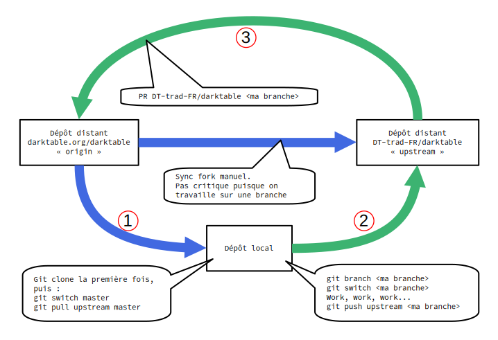

# DT-trad-Script
## Pourquoi ?
Faciliter l'utilisation des dépôts Git darktable.org et DT-trad-FR à l'aide de scripts (bash).

## Comment ?
Après beaucoup d’essais infructueux, nous avons modifié le workflow. Au lieu d’une liaison bipartite entre vos dépôts locaux et le dépôt DT-trad-FR, nous établissons une liaison tripartite en ajoutant le dépôt principal de darktable (darktable.org). Ainsi, il n’est plus nécessaire de maintenir à jour très strictement le dépôt DT-trad-FR. Voici le diagramme de fonctionnement.



Le principe est d’aller chercher les modifications sources directement à partir du dépôt principal de Darktable, de faire les modifications que l’on souhaite sur sa machine (poedit), puis de pousser ces modifs vers le dépôt DT-trad-FR.
Une fois ces modifications disponibles sur ce dépôt, elles seront regroupées (rebase) pour pouvoir créer une PR à l’attention de Pascal.

## Clé ssh

Vous devez définir définir la clé SSH qui sera utilisée pour le push :

1. sur sa machine créer une clé SSH **si ce n'est pas déjà fait** : 
   `ssh-keygen -t ed25519 -C \<contact@foo.home\>`
   (remplacer contact@foo.home par son adresse mail)
2. récupérer la ligne contenue dans le fichier `~/.ssh/id\_ed25519.pub`
3. Sur GitHub, compte DT-trad-FR → Settings → SSH and GPG keys : créer une **New SSH key** 
   1. `Title` : clé de _foo_
   2. `Key type` : Authentication key (valeur par défaut).
   3. `Key` : la ligne récupérée au point 2 ci-dessus.

**Cette opération est à réaliser une seule fois.**

## Les scripts

Les scripts sont disponibles dans ce dépôt dans le dossier `src`  
Ils comprennent en trois parties (fichiers) :

```shell
DT-trad.sh
DT-preTrad.sh
DT-posTrad.sh
```
Avant de les utiliser, il est indispensable de personnaliser le fichier `DT-preTrad.sh`.

### DT-preTrad.sh

Il y a quatre variables à modifier : 

1. `localBaseFolder="path"` : `path` est le chemin d'accès au dossier racine du clone, **SANS** le dossier nommé darktable.
C'est dans ce dossier qu'est cloné Darktable. N'utilisez pas le `~` pour nommer votre répertoire personnel. Utilisez, si nécessaire, la variable `$HOME`.
2. `gitUser="GitHup username"` : son username tel que défini dans GitHub
3. `gitEmail="GitHub email"` : l'adresse mail telle que définie dans GitHub
4. `gitBranch="BR_pseudo"` : remplacer `pseudo` par un pseudo perso et laisser le préfixe `BR_`

Une fois ces modifications réalisées, il n'y a plus à revenir sur ce script. 
Il est utilisé par les deux autres scripts. 

### DT-Trad.sh

Il s'agit du **script principal**.

Le script enchaîne pour vous les opérations suivantes :

1. Vérification de la présence du logiciel Git sur la machine.
   
2. Vérification de la présence d’un dossier darktable, là où vous voulez cloner le dépôt principal de darktable. 
   Si ce dossier exite le script demande s'il s'agit déjà d'un clone de darktable.org et dans ce cas le renomme DT-trad-FR.

3. Si le dépôt DT-trad.FR n’existe pas :
   1. Clonage du dépôt principal de darktable et renommage en DT-trad-FR.
   2. Modification du fichier `DT-trad-FR/.git/config` dans votre clone du dépôt DT-trad-FR. ([voir les modifications ci dessous](#configuration-git-de-votre-clone-du-dépot-dt-trad-fr)).
   3. Création de la branche de travail.

4. Si le dépôt DT-trad-FR existe déjà :
   1. Positionnement sur la branche master.
   2. pull du dépôt principal de darktable.

5. Positionnement sur la branche de travail.
   
6. lancement de **poedit** pour réaliser les modifications de traduction (si poedit installé)

Quand vous quittez **poedit** le script `DT-Trad.sh` enchaîne avec le script `DTposTrad.sh`.

### DT-posTrad.sh

Ce script vous propose de pousser la branche de travail vers le dépôt DT-trad-FR.

Si vous acceptez, le script vous demandera alors de saisir le libellé du commit. Puis exécutera les commandes Git nécessaires pour envoyer vos traductions vers le dépôt DT-trad-FR.

Si vous ne souhaitez pas envoyer sur-le-champ vos traductions, le script s'arrêtera là.

Si vous n'avez pas poussé vos traductions lors de la sortie de **poedit**, vous pouvez utiliser ce script indépendamment pour pousser vos traductions quand vous en convenez.

### Conclusion

Vous pouvez donc vous appuyer systématiquement sur ces scripts pour effectuer vos traductions de l’UI.

N'utilisez plus/pas directement **poedit**, utilisez _**TOUJOURS**_ **DT-Trad.sh**

Lorsque vous avez fini vos traductions et les avez poussées vers le dépôt DT-trad-FR, n'oubliez pas de prévenir sur Signal le mainteneur du dépôt DT-trad-FR que de nouvelles traductions ont été poussées.

De même, le mainteneur du dépôt DT-trad-FR se renseignera systématiquement des traductions en cours **AVANT** de lancer la PR Darktable.org, et il préviendra également au moment de chaque PR de sorte que les traducteurs attendent que celle-ci soit prise en compte sur le dépôt Darktable.org.

## Configuration git de votre clone du dépot DT-trad-FR 

**Pour information**, car réalisé par DT-trad.sh à l'initialisation du clone local.

Configuration du dépôt DT-trad-FR dans le fichier de configuration de Git (emplacement : `<dossier du clone>/.git/config`).

Voici ce fichier suite aux modifications.

```shell
[core]
	repositoryformatversion = 0
	filemode = true
	bare = false
	logallrefupdates = true

[remote "origin"]
	url = https://github.com/darktable-org/darktable.git
	fetch = +refs/heads/\*:refs/remotes/origin/\*

[branch "master"]
	remote = origin
	merge = refs/heads/master

[user]
	name = foo
	email = [contact@foo.home](mailto:contact@foo.home)

[remote "upstream"]
	url = git@github.com:DT-trad-FR/darktable.git
	fetch = +refs/heads/\*:refs/remotes/upstream/\*
```

## Maintenance du dépôt DT-trad-FR

### Synchronisation du fork

Comme expliqué, le fork ne doit plus être synchronisé systématiquement puisque la branche master n’est plus utilisée. Néanmoins une mise à jour régulière évitera des problèmes.

> Bouton **Sync fork** dans l'onglet `Code` du dépôt [DT-trad-FR/darktable](https://github.com/DT-trad-FR/darktable)

### En cas de besoin de résolution des conflits et merge

La résolution de conflits ne concerne que le cas où plusieurs branches ont été poussées par différents traducteurs. 
Dans le cas d'une simple branche reçue sur le dépôt DT-trad-FR, il suffit de passer au chapitre suivant.

Méthode la plus courante et sécurisée pour fusionner une branche personnelle dans une autre branche personnelle.

1. Aller sur le dépôt [DT-trad-FR/darktable](https://github.com/DT-trad-FR/darktable)
   
2. Cliquer sur l'onglet `Pull requests` en haut de la page.
3. Cliquez sur le bouton **New pull request**.
4. Dans les menus déroulants : à gauche remplacer base `repository darktable.org/darktable` par `DT-trad-FR/darktable`, puis dans
   - `base` : choisir la branche personnelle d'un traducteur la plus ancienne qui va recevoir les nouvelles traductions (ex: BR_manu).
   - `compare` : choisir la branche d'un autre traducteur contenant ses nouvelles traductions (ex: BR_jpv).
5. GitHub affiche en bas de page un récapitulatif des commits et des différences. Cliquer sur **Create pull request**.
6. Au cas où GitHub affiche "This branch has conflicts that must be resolved", cliquer sur **Resolve conflicts**.
   1. dans l'éditeur affiché, 
   2. arbitrer les modifications dans les différentes sections entre les <<<<, ===== et >>>>>
      retirer ce qui doit l'être : lignes <<<<<<, ======= et >>>>>
   3. Cliquer sur **Mark as resolved**, puis sur **Commit merge**.
   4. Valider en cliquant sur **Merge pull request**, insérer un commentaire puis **Confirm merge**.
7. Sinon (pas de conflit à résoudre), mettre éventuellement un titre et refaire **Create pull request**.
8. Cliquer sur **Delete branch** pour supprimer la branche de traduction devenue inutile.
9. Réitérez l'opération s'il y a plus de deux braches à fusionner.

### Pull Request pour darktable.org
Dans l'onglet `Pull request` de la page d'accueil du dépôt, cliquer sur le bouton **New pull request**.  
Ne pas changer `base repository : darktable.org/darktable` ni `base : master`  

Ne pas changer `head repository` mais changer `compare : <nom de la branche du traducteur conservée>`  

Git affiche une page récapitulant tous les commits qui vont faire partie de la PR.  
Puis cliquer sur le bouton **Create pull request**.

